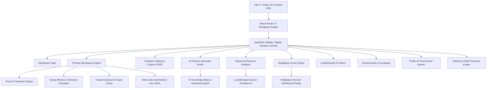

# CodeType (Devtype 2.0) — Complete Product Guide & Product Requirements Document (PRD)

---

## 1. Executive Summary & Product Vision

### 1.1 Executive Summary
**CodeType** (internal development name: **Devtype 2.0**) is an elite, developer-first typing mastery and algorithmic telemetry platform. While conventional typing test platforms (e.g., Monkeytype, 10FastFingers, TypeRacer) evaluate touch-typing speed using conversational English prose, developers spend their working hours typing a completely different visual and tactile language: indentation blocks, camelCase/snake_case identifiers, syntax keywords, semicolons, brackets, pointer operators (`->`, `*`), lambdas, and complex punctuation.

CodeType bridges this critical gap. It combines:
1. **Real-world code syntax typing drills** across 8 leading programming languages.
2. **Algorithmic and systems engineering blueprints** (Data Structures, Algorithms, Concurrency, SQL, Web).
3. **An intelligent AI Practice Generator** that synthesizes code snippets tailored to user specifications.
4. **Comprehensive developer telemetry and diagnostic analytics** (WPM velocity curves, language-specific mastery, syntax error categorization).
5. **A 7-mode competitive multiplayer arena** ready for real-time developer esports.
6. **A rich gamification layer** featuring XP progression, levels, 46 technical achievements, global leaderboards, and social peer connections.

### 1.2 Target Audience
- **Software Engineers & Systems Developers:** Engineers seeking to reduce the physical latency between thought and code.
- **Computer Science Students & Interview Candidates:** Students practicing LeetCode/HackerRank algorithmic implementations to build motor-memory fluency before high-pressure technical interviews.
- **Competitive Programmers:** Developers seeking sub-second execution speed on data structure templates.
- **Polyglot Programmers:** Engineers learning the syntax and idioms of a new language (e.g., transitioning from Python to Rust or Go).

---

## 2. Core Purpose & Problem Statement

### 2.1 The Problem
- **Prose Typing ≠ Code Typing:** Normal typing platforms measure words-per-minute on standard dictionary words. Typing `for (int i = 0; i < n; i++) { ... }` or `fn handle_stream<T: AsyncRead + Unpin>(mut stream: T) -> Result<()>` requires fingers to navigate symbol rows (`{}`, `()`, `[]`, `<>`, `&`, `|`, `*`, `;`), which is where most programmers experience severe velocity drops and keystroke errors.
- **Lack of Code-Aware Telemetry:** Traditional tools only report net WPM and generic accuracy. They do not diagnose *why* a programmer is slow (e.g., bracket misplacement, indentation friction, or punctuation hesitation).
- **Static & Repetitive Exercises:** Existing coding typing websites offer static, outdated code fragments with no mechanism to generate customized snippets on demand.

### 2.2 The Solution: CodeType
- **PrismJS-Powered Syntax Highlighting & Tokenization:** Characters are evaluated token-by-token with syntax awareness, preserving real code structure, comments, and clean indentation.
- **Granular Diagnostic Telemetry:** Classifies syntax errors into four distinct buckets: **Brackets**, **Punctuation**, **Identifiers**, and **Whitespace**.
- **On-Demand AI Practice Generation:** Generates code snippets on the fly based on language, difficulty tier, length mode, and natural language prompts.
- **Interactive Virtual Keyboard with Finger Placement:** Highlights optimal finger assignment zones for high-frequency programming symbols.
- **Competitive Esports Architecture:** Real-time racing simulations and WebSocket-ready service layers across 7 distinct game modes.

---

## 3. High-Level Architecture & Technical Stack

### 3.1 Technology Stack Details
| Layer | Technology | Rationale |
|---|---|---|
| **Core Framework** | React 19 (`react`, `react-dom`) | Concurrent rendering, modern hooks, predictable UI state. |
| **Build Tooling** | Vite 8 + `@vitejs/plugin-react` | Instant Hot Module Replacement (HMR), lightweight bundle size. |
| **Routing** | React Router DOM v7 | Nested route hierarchy (`/`, `/dashboard`, `/practice`, `/templates`, etc.) with state-passing. |
| **Styling & Aesthetics** | Pure Vanilla CSS (`index.css` ~187 KB) | Custom Apple Cupertino/Obsidian dark-mode design system with CSS custom properties and liquid glass effects. Zero framework overhead. |
| **Syntax Highlighting** | PrismJS | Granular character tokenization and grammars for C++, Python, JS, TS, Java, Rust, Go, SQL. |
| **Visual Analytics** | Recharts v3 | Responsive velocity progression curves, accuracy lines, language benchmarks, and activity bar charts. |
| **Audio Feedback** | Web Audio API (`AudioContext`) | Ultra-low-latency synthesized mechanical keyboard click sound effects with zero external audio assets. |
| **Delight & Gamification** | Canvas-Confetti | Lightweight celebratory physics animations upon completing sessions or unlocking achievements. |
| **Iconography** | Lucide React | Modern, clean stroke icons matching macOS Cupertino aesthetic. |
| **State Persistence** | LocalStorage API + Modular Stores | Zero-backend bootstrap allowing instant client-side persistence for sessions, templates, profiles, friends, achievements, and settings. |

---

## 4. Comprehensive Feature & Page Breakdown

### 4.1 Global AppShell & Sidebar Navigation
- **macOS Window Controls:** Authentic traffic lights (`close`, `minimize`, `zoom`).
- **Brand Identity:** Custom inline SVG `<CodeType />` mark in pure vector paths.
- **Primary Navigation Links:**
  - `Dashboard` (`/dashboard`)
  - `Templates` (`/templates`)
  - `AI Generator` (`/ai-generator`)
  - `Reports` (`/reports`)
  - `Multiplayer` (`/multiplayer`)
  - `Leaderboard` (`/leaderboard`)
  - `Achievements` (`/achievements`)
- **Quick Workspace Recent Items:** Direct 1-click links to active snippets (LRU Cache in C++, Binary Search in C++, Two Sum in Python, Debounce Fn in JS).
- **Persistent Bottom User Footprint:** Displays user avatar initials (`SP`), full display name (`Alex Spoor`), active level (`Level 24`), accumulated XP (`24.8k XP`), and real-time level progress bar (`82%`). Clicking routes directly to the Profile page.
- **Settings Navigation:** Anchored cog button with clean navigation arrow.

---

### 4.2 Dashboard (`/dashboard`)
The central executive hub giving the developer an instant overview of their performance, active routines, and daily commitments.
- **Liquid Glass Header:** Humanized contextual greeting based on local client hour (*"Good morning/afternoon/evening, Developer 👋"*), motivation quote, and dynamic date widget.
- **Daily Practice Streak Tracker:** Displays continuous day streak with flame icon.
- **Top Metrics Grid (4 Cupertino Glass Stat Cards):**
  1. **Best WPM (Rose tone):** All-time velocity peak.
  2. **Accuracy (Emerald tone):** All-time keystroke precision percentage.
  3. **Practice Sessions (Cobalt tone):** Total count of completed typing sessions.
  4. **Current Streak (Amber tone):** Active consecutive day count with personal best comparison.
- **Current Practice Spotlight Card:** Preview of the active coding session with syntax highlights, language badge (`C++`), difficulty badge (`Intermediate`), and 1-click "Start Typing" button.
- **Today's Challenge Card:** High-yield challenge card (e.g. *LRU Cache*, 50 XP bounty) with algorithm description and dual actions ("Start Challenge" or "View all challenges").
- **Practice Activity Heatmap:** 52-week annual contribution grid with year navigation (2023–2026), intensity levels (0–5), and hover tooltips displaying date and session counts.
- **Usage & Progress Card:** Level progress meter (Current XP / Next Level Target), total accumulated practice duration, and earned XP.
- **Recent Sessions Table:** Displays recent completed runs with language indicator dot, challenge name, Net WPM, accuracy %, and date. Includes an empty state with prompt when no sessions are recorded.

---

### 4.3 Practice Workspace Engine (`/practice`)
The flagship interactive typing engine designed for syntax accuracy, physical finger ergonomics, and live feedback.
- **Deep Linking Support:** Accepts URL query parameters `?snippet=<id>` and `?lang=<lang>` or React Router location state.
- **Code Practice Editor (`CodePracticeEditor`):**
  - **Syntax Parsing:** Powered by PrismJS; tokens are flattened into indexed character streams (`CodeCharData[]`) maintaining line numbers, column numbers, and whitespace metadata.
  - **Character States:**
    - *Untyped:* Subdued text color.
    - *Current Caret:* Glowing animated cursor indicating exact position.
    - *Correct:* Colored in syntax-highlighted token hue.
    - *Error:* Bright warning red with subtle background highlight.
  - **Smart Indentation (Tab Key):** Pressing `Tab` automatically advances through up to 4 leading indentation spaces in a single keystroke.
  - **Newline Handling (Enter Key):** Evaluates `\n` transitions to mirror actual coding behavior.
  - **Typing Modes:**
    - *Free Mode:* Allows continuous typing; typists can ignore mistakes and keep going.
    - *Strict Mode:* Imposes real compiler discipline; errors **must** be corrected using Backspace before advancing.
  - **Pause/Resume via Escape:** Typists can hit `Esc` or click away to pause the session timer.
- **Interactive Virtual Keyboard (`VirtualKeyboard`):**
  - Displays full 4-row QWERTY keyboard layout.
  - Highlights physical keys as they are pressed in real time (`lastPressedCode`).
  - Highlights the **Next Target Character** to press.
  - **Color-Coded Finger Zones:** Visual guidance indicating which finger (left/right pinky, ring, middle, index, thumbs) should strike each symbol.
  - **Web Audio Sound Effects:** Synthesized mechanical click sound with sound toggle.
- **Snippet Blueprint Card (`SnippetBlueprintCard`):** Displays snippet title, filename, category, tags, language, difficulty, and quick mode switcher (`Free` vs `Strict`).
- **Telemetry Card (`PracticeTelemetryCard`):**
  - Live Net WPM, Gross WPM, Accuracy %, and Progress bar.
  - **Streak Counter:** Number of consecutive correct keystrokes.
  - **Peak WPM:** Highest instantaneous speed achieved during the run.
  - **Syntax Error Diagnostics:** Real-time categorized error counters:
    - *Brackets:* `{ } ( ) [ ] < >`
    - *Punctuation:* `; : , . " ' = + - * / % & | ^ ! ?`
    - *Whitespace:* Space, tab, newline
    - *Identifiers:* Variable/function names, keywords, literals
- **Practice Results Modal (`PracticeResultsModal`):**
  - Fires celebratory confetti animation (`canvas-confetti`).
  - Displays Net WPM, Gross WPM, Accuracy %, Total Keystrokes, Total Errors, Duration, and XP Earned.
  - **Performance Tier Badge:** Evaluates run against developer benchmarks (*Grandmaster Coder*, *Code Ninja*, *Senior Engineer*, *Junior Typist*).
  - Actions: "Retry Snippet", "Next Snippet", or "Back to Dashboard".
- **Confirmation Dialogs (`ConfirmDialog`):** Guards against losing active typing progress when resetting or quitting mid-session.

---

### 4.4 Template Catalog & Custom Templates (`/templates`)
The library of curated programming exercises, algorithms, and user-created snippets.
- **Search & Multi-Dimensional Filters:**
  - Free-text search across titles, descriptions, tags, and source code.
  - Category tabs: *All Collections*, *Data Structures*, *Algorithms*, *Concurrency*, *Web & Async*, *SQL & Analytics*.
  - Language filter badges: *C++*, *Python*, *JavaScript*, *TypeScript*, *Java*, *Rust*, *Go*, *SQL*.
  - Difficulty filters: *Beginner*, *Intermediate*, *Advanced*.
  - Sorting options: *Most Popular*, *Newest First*, *Difficulty (Asc/Desc)*, *Length (Shortest/Longest)*.
  - View switcher: Responsive Card Grid view vs. Compact List view.
- **Spotlight Template Card:** Hero card highlighting high-frequency interview classics (e.g. *LRU Cache*).
- **Template Card Components:** Displays title, category icon, difficulty pill, estimated duration, popularity metric, XP bounty, tags, code preview, and 1-click "Practice" action.
- **Template Detail Modal (`TemplateDetailModal`):** Modal with full code view, line numbers, syntax highlighting, prerequisites, and direct launch button.
- **Create Custom Template Modal (`CreateTemplateModal`):**
  - Allows typists to input their own code.
  - Fields: Snippet Title, Language, Difficulty, Category, Tags, Code body.
  - Actions: "Save to Catalog" or "Save & Start Practicing Now".
  - Persists directly into `templateStore.js` and LocalStorage.

---

### 4.5 AI Practice Generator (`/ai-generator`)
An on-demand code synthesis workshop tailored to custom learning needs.
- **Generation Controls:**
  - **Natural Language Prompt:** Accepts custom prompts (e.g., *"Implement a lock-free concurrent queue in C++"*).
  - **Quick Prompt Presets:** 1-click prompt chips for rapid testing (LRU Cache, Thread-safe Counter, Async Retry, Binary Search, Dijkstra, Debounce).
  - **Language Selector:** Supports all 8 target languages with distinct brand color accents.
  - **Difficulty Selector:** Beginner, Intermediate, Advanced.
  - **Length Mode:** *Compact* (~10–15 lines sprint), *Balanced* (~20–30 lines standard drill), *Deep* (~40+ lines comprehensive architecture).
  - **Inline Comments Toggle:** Option to include or omit explanatory comments.
- **Synthesis Engine (`aiGeneratorStore.js`):**
  - Curated semantic matching and synthetic generation engine.
  - Realistic generation delay with animated spinner and loading states.
- **Output Workbench & Telemetry:**
  - Live syntax-highlighted code block.
  - Computed snippet diagnostics: Total character count, line count, and estimated completion time at 60 WPM.
  - Actions:
    - **Start Practice:** Transfers snippet directly into the Practice Workspace via React Router state.
    - **Save to Templates:** Exports snippet into the Custom Templates store.
    - **Copy Code:** Copies raw code to the system clipboard.
    - **Regenerate:** Generates alternative implementation.
- **AI Generation History:** Sidebar/drawer tracking previously generated snippets with 1-click reload.

---

### 4.6 Reports & Telemetry Analytics (`/reports`)
Comprehensive performance insights built with Recharts to analyze typing evolution over time.
- **Timeframe Filtering:** *7 Days*, *30 Days*, *90 Days*, *All Time*.
- **Executive Stat Cards:**
  - *Best Net Speed (WPM)*
  - *Average Net Speed (WPM)*
  - *Average Accuracy (%)*
  - *Total Practice Time (Minutes/Hours)*
  - *Total Drills Completed*
- **Speed Velocity & Accuracy Progression Curve (Interactive Dual-Axis Line Chart):**
  - Tracks session-by-session Net WPM (Blue curve) and Keystroke Accuracy % (Green curve).
  - Custom liquid glass tooltip showing session title, date, language badge, Gross WPM, Net WPM, and Accuracy %.
- **Language Mastery & Benchmark (Bar Chart):**
  - Compares average WPM across programming languages.
  - Helps typists identify language syntax where they hesitate (e.g., comparing fast Python syntax to complex C++ template syntax).
- **Daily Practice Time Distribution (Bar Chart):**
  - Breaks down practice minutes and drill counts by day of the week (Monday through Sunday) to evaluate consistency.
- **Drill History Table:**
  - Searchable list of past sessions.
  - Shows Language, Snippet Name, Net WPM, Gross WPM, Accuracy, Duration, and Date.
  - 1-click **"Re-practice"** button to retry any past snippet immediately.
- **Data Export & Portability:**
  - 1-click **"Export CSV"** button downloads complete session history as a structured `.csv` file.
- **Empty State & Demo Seed Data:**
  - Includes an empty state with a "Load Demo Data" seed button so evaluators can inspect charts immediately without typing 50 sessions first.

---

### 4.7 Competitive Multiplayer Arena (`/multiplayer`)
The developer esports arena supporting real-time and asynchronous head-to-head racing.
- **Service Layer Architecture (`multiplayerService.js`):**
  - Clean separation between mock simulation and WebSocket network interfaces (`createRoom`, `joinRoom`, `onProgressUpdate`, `onMatchEnd`).
  - Ready for immediate socket backend integration.
- **Seven Game Modes:**
  1. **Classic Race:** First developer to type all lines with correct syntax wins.
  2. **1v1 Ranked Duel:** Competitive ELO match with strict accuracy penalties.
  3. **Battle Royale:** 8–32 player survival arena with elimination checkpoints.
  4. **Relay Race:** Squad-based relay where teammates hand off the cursor baton between functions.
  5. **Ghost Race:** Time attack against recorded telemetry of personal bests or leaderboard records.
  6. **Boss Fight:** Co-op raid where aggregate team WPM inflicts real-time DPS against a simulated boss.
  7. **Bug Fix Race:** Time-pressured debugging sprint to find and patch syntax/logic errors.
- **Arena Hub & Lobby Browser:**
  - Searchable list of open lobbies with ping indicators (`24ms`), language tags, player counts (`3/6`), and game mode badges.
  - Quick Match button for instant lobby allocation.
  - Create Room Modal: Set custom room title, mode, language, difficulty, player capacity (2 to 16), private room toggle, and bot filler simulation.
- **Live Match Engine:**
  - Pre-match room with participant list, bot benchmarks, ready-up status, and synchronized 3-2-1 countdown.
  - Split-screen race track: Live racer progress bars updating WPM, completion percentage, and current position.
  - Synchronized typing engine with `CodePracticeEditor` and `VirtualKeyboard`.
  - Final Results Podium: 1st, 2nd, and 3rd place standings with WPM, accuracy, duration, and XP awards.

---

### 4.8 Global & Regional Leaderboard (`/leaderboard`)
The competitive ranking system recognizing elite typists.
- **Top-3 Podium Cards:**
  - 1st Place (Gold Crown halo, level badge, avatar, XP/WPM score, accuracy, total sessions).
  - 2nd Place (Silver Medal).
  - 3rd Place (Bronze Award).
  - Visual `YOU` indicator highlighting the current user's entry.
- **Filters & Metric Controls:**
  - Metric switcher: **Speed (WPM)** vs. **Experience (XP)**.
  - Timeframe: *All Time*, *This Month*, *This Week*, *Today*.
  - Language: Filter rankings by specific programming language stacks.
  - Search bar to find specific developer handles.
- **Full Rankings Table:**
  - Complete list (#1 to #50+) with rank numbers, avatars, handles, titles, primary languages, Net WPM, accuracy %, session count, and total XP.
  - Sticky **"Your Current Standing"** bar anchored to ensure the user always knows their rank relative to the top percentiles.

---

### 4.9 Achievements & Developer Accolades (`/achievements`)
Gamification framework rewarding dedication, speed, accuracy, and versatility.
- **46 Configurable Badges across 6 Categories:**
  - *Speed:* 60 WPM, 80 WPM, Centurion 100 WPM, Overclocked 120 WPM, Hyperscale 140 WPM.
  - *Accuracy & Precision:* Flawless Syntax (100% accuracy), Precision Engineer (98%+ over 50 runs).
  - *Volume & Milestones:* First Commits (10 runs), Century Club (100 runs), Marathon Coder.
  - *Streaks:* 7-Day Sprint, Fortnight Coder, 30-Day Dedication.
  - *Polyglot:* Systems Specialist (C++/Rust), Web Hacker (JS/TS), Backend Architect (Go/Java).
  - *Multiplayer:* Duelist, Podium Finisher, Royale Champion.
- **Progress Tracking & Accolade Rewards:**
  - Radial progress ring showing % of achievements unlocked.
  - Total earned XP vs. potential XP counter.
  - Tiered breakdown pills: Easy (Emerald), Medium (Amber), Hard (Rose).
- **Interactive Badge Detail Modal:** Clicking any achievement opens an inspection modal displaying badge requirements, unlocked timestamp, XP reward, and coaching tips.

---

### 4.10 Developer Profile & Community (`/profile`)
The public-facing and personal identity page for typists.
- **Liquid Glass Profile Header:**
  - Large avatar with customizable background gradient presets.
  - Display name, handle (`@alexspoor`), level badge (`Level 24`), and developer title (`Senior Systems Architect`).
- **Edit Profile Modal:** Allows users to modify their display name, title, bio, and avatar color gradient with immediate persistence.
- **Lifetime Career Telemetry:**
  - Best WPM, Average Accuracy %, Total Sessions, Total Practice Time, Current Streak, Total XP.
- **Algorithmic Skill Breakdown:** Visual mastery bars across Data Structures, Algorithms, Concurrency, Dynamic Programming, and System Design.
- **Embedded Activity Heatmap:** Personal 365-day practice heatmap.
- **Friends & Peer Network System:**
  - *Connected Friends Tab:* View friends list, online status, primary language, best WPM, and direct profile peek.
  - *Received Requests Tab:* Manage incoming peer invites with 1-click Accept / Decline.
  - *Sent Requests Tab:* Track pending outgoing friend invites.
  - *Add Friend Modal:* Search by `@handle` with confirmation and state persistence.

---

### 4.11 Settings & Configuration (`/settings`)
User preferences, account management, and system configuration.
- **Timezone & Streaks:**
  - IANA Timezone selector (UTC, EST, PST, GMT, CET, IST, JST, SGT).
  - Synchronizes daily challenge resets and streak midnight boundaries with the user's physical geographic location.
- **Account & Credentials Management:**
  - Update DevType ID modal.
  - Update Login Email address modal.
  - Change Password modal with confirmation feedback.
- **Danger Zone:**
  - Delete Account action with confirmation modal and 30-day reactivation grace lock.
- **Floating AI Assistant Trigger:** Quick floating pill button to summon the AI practice generator from any settings screen.

---

## 5. Algorithmic Specifications & Telemetry Formulas

### 5.1 Typing Velocity Formulas
CodeType uses standard international typographic standards adjusted for code precision:

1. **Standard Word Length:**
   $$\text{Words} = \frac{\text{Total Keystrokes}}{5}$$

2. **Gross Words Per Minute (Gross WPM):**
   $$\text{Gross WPM} = \text{round}\left(\frac{\text{Total Keystrokes} / 5}{\text{Elapsed Minutes}}\right)$$

3. **Net Words Per Minute (Net WPM):**
   $$\text{Net WPM} = \text{round}\left(\max\left(0, \frac{(\text{Correct Characters} / 5) - \text{Uncorrected Errors}}{\text{Elapsed Minutes}}\right)\right)$$

4. **Keystroke Accuracy Percentage:**
   $$\text{Accuracy} = \text{round}\left(\frac{\text{Total Keystrokes} - \text{Total Errors}}{\text{Total Keystrokes}} \times 100\right)$$

### 5.2 Syntax Error Categorization
Every incorrect keypress is inspected against the target character and classified:
- **Brackets:** If target is in `{ } ( ) [ ] < >`
- **Punctuation:** If target is in `; : , . " ' = + - * / % & | ^ ! ~ ? @ # $ \ \` `
- **Whitespace:** If target is space (` `), tab (`\t`), or newline (`\n`)
- **Identifiers:** All alphanumeric characters representing variables, keywords, types, or function identifiers

### 5.3 Performance Tier Matrix
| Tier Name | Badge | Min WPM | Min Accuracy | Description |
|---|---|---|---|---|
| **Grandmaster Coder** | ⚡ Supreme | 90+ | 97%+ | Flawless muscle memory on complex syntactic structures. |
| **Code Ninja** | 🚀 Elite | 75–89 | 95%+ | Rapid typing with minimal syntax friction. |
| **Senior Engineer** | 💻 Advanced | 60–74 | 93%+ | Solid, professional coding pace exceeding standard velocity. |
| **Junior Typist** | 🎯 Developing | <60 | Any | Building foundational finger placement and symbol memory. |

---

## 6. Data Storage & Schema Reference (LocalStorage)

CodeType utilizes structured client-side storage keys to ensure zero-backend functionality while remaining fully compatible with future REST/GraphQL endpoints:

| Storage Key | Type | Description |
|---|---|---|
| `devtype_sessions` | `Array<SessionResult>` | History of completed typing sessions (last 50 runs). |
| `devtype_custom_templates` | `Array<CodeSnippet>` | Custom user-created code snippets. |
| `devtype_ai_history` | `Array<AiSnippet>` | Previously synthesized AI prompts and code. |
| `devtype_achievements` | `Array<Achievement>` | State of 46 unlocked/locked achievement badges. |
| `devtype_profile` | `UserProfile` | Display name, handle, title, bio, avatar gradient, and level. |
| `devtype_friends` | `FriendStore` | Lists of connected, received, and sent friend invites. |
| `codetype_tz` | `string` | User's preferred IANA timezone (e.g. `UTC`, `Asia/Kolkata`). |
| `codetype_devid` | `string` | User's unique DevType ID handle. |
| `codetype_email` | `string` | User's registered account email. |

---

## 7. Current Implementation Status vs. Future Roadmap

### 7.1 What is Implemented & Fully Functional (Status: Production Ready)
- [x] **Complete Application Shell & Navigation:** Responsive sidebar, traffic lights, and active route switching.
- [x] **Dashboard:** Live stat cards, streak counter, spotlight challenge, annual activity heatmap, and recent sessions list.
- [x] **Practice Workspace Engine:** PrismJS character-by-character tokenization, caret tracking, Free vs. Strict modes, Tab indentation advancement, Escape pause, mechanical sound effects, and celebratory confetti modal.
- [x] **Interactive Virtual Keyboard:** Real-time keypress illumination and color-coded finger placement zones.
- [x] **Templates Catalog:** Multi-category filtering, language filtering, difficulty sorting, detail modals, and custom template creation.
- [x] **AI Practice Generator:** Prompt input, preset chips, language/difficulty/length customization, code preview, and generation history.
- [x] **Reports & Analytics:** Recharts velocity curves, language comparison bars, daily time distribution, drill history table, and CSV data export.
- [x] **Multiplayer Arena UI & Simulation:** Hub with 7 game modes, lobby browser, custom room creation, ready-up sequence, split-screen race progress, and podium results.
- [x] **Leaderboard:** Top-3 podium cards, speed vs. XP toggle, timeframe filters, language filters, and sticky user ranking.
- [x] **Achievements:** 46 badges across 6 categories, unlock progress rings, tier breakdown, and inspect modals.
- [x] **Profile & Social System:** Profile editing, avatar presets, career stats, skill breakdown, and friend request management.
- [x] **Settings:** IANA timezone selection, credentials editing, and danger zone account deletion.

### 7.2 Recommended Future Enhancements (Backend Integration)
1. **Real-time WebSockets / Socket.io Backend:** Replace the deterministic multiplayer simulation with a Node.js/Go WebSocket server for live human vs. human matchmaking.
2. **PostgreSQL / MongoDB Cloud Persistence:** Sync user sessions, achievements, and custom templates across devices via JWT authentication.
3. **Live LLM API Integration:** Connect the AI Practice Generator to an OpenAI, Anthropic, or Gemini API endpoint for dynamic real-time snippet synthesis.
4. **GitHub / LeetCode OAuth Integration:** Import solved LeetCode solutions or GitHub commits directly into personalized practice drills.
