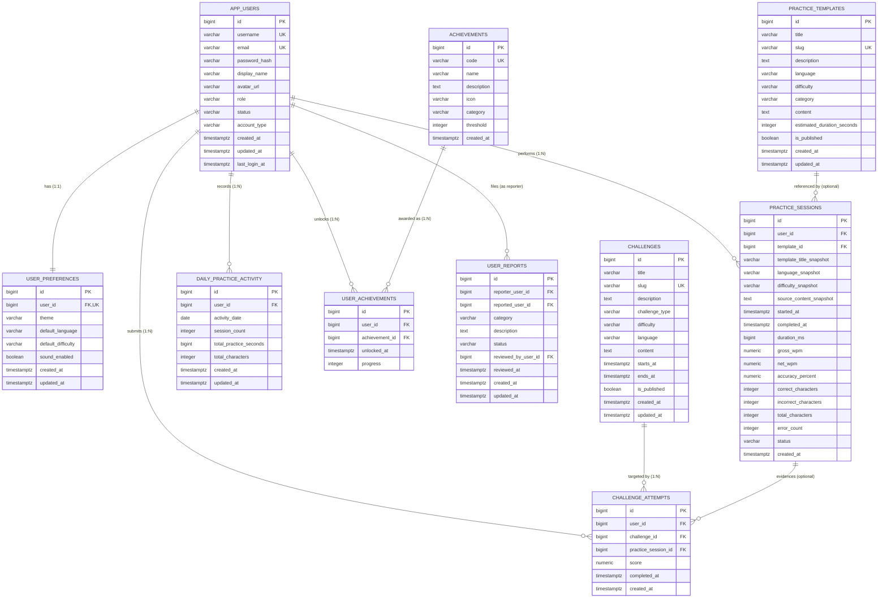

# DevType Backend — Modular Monolith Foundation

Production-conscious Spring Boot backend for **DevType**, an elite, multi-user code typing and developer telemetry platform.

---

## 1. Prerequisites

- **Java 21 or higher** (JDK 21 LTS or compatible runtime)
- **Maven 3.9+** (The project includes the Maven Wrapper: `./mvnw` on Linux/macOS, `.\mvnw.cmd` on Windows)
- **Git** for version control
- A free or paid **Neon PostgreSQL** serverless cloud instance ([neon.tech](https://neon.tech))

---

## 2. Architecture Overview

DevType uses a **modular monolith** architecture designed for future horizontal scalability while maintaining strict domain encapsulation.

The root package is `com.devtype`, organized into isolated feature packages:

| Package | Domain Responsibility |
|---|---|
| `com.devtype.config` | Global framework configuration (CORS, JPA Auditing, security). |
| `com.devtype.common` | Shared base entities (`BaseEntity`, `CreatedEntity`, `AuditableEntity`), unified API envelope (`ApiResponse<T>`), structured error responses (`ErrorResponse`), and global exception handling (`GlobalExceptionHandler`). |
| `com.devtype.monitoring` | Operational health and uptime check endpoints (`/api/v1/health` and Actuator). |
| `com.devtype.auth` | Authentication boundary, JWT tokens, credential hashing, and session management. |
| `com.devtype.user` | User accounts, profiles, user data isolation, user preferences, and moderation reports. |
| `com.devtype.template` | Syntax drills, language algorithms, and custom code practice templates. |
| `com.devtype.practice` | Keystroke telemetry, WPM computation, accuracy snapshots, and session records. |
| `com.devtype.dashboard` | User dashboard telemetry, streak tracking, and 52-week activity heatmaps. |
| `com.devtype.challenge` | Scheduled and evergreen coding challenges and competitive attempt leaderboards. |
| `com.devtype.achievement`| Platform badge catalog and unlocked user achievements. |
| `com.devtype.leaderboard`| Competitive leaderboards, top-3 podiums, and percentiles. |
| `com.devtype.multiplayer`| Real-time and asynchronous racing lobbies, game modes, and results. |
| `com.devtype.admin` | Administrative governance, snippet moderation, and user management. |

### Architectural Principles
- **Constructor Injection:** All Spring components use explicit constructor injection for immutability, testability, and compile-time safety.
- **Zero Sensitive Data Leakage:** Exceptions, stack traces, and database credentials are fully sanitized before API responses are emitted.
- **Separation of Concerns:** Controllers handle transport serialization, Services contain domain business rules, Repositories handle database interactions, and Entities define relational schemas.
- **No Uncontrolled Cascading / Serialization Loops:** Unnecessary bidirectional relationships are avoided. Entities are never returned directly through REST endpoints; DTO projections are required.

---

## 3. Database Schema & Entity Relationships

The relational database schema is engineered for strict multi-user privacy, historical telemetry immutability, and zero-downtime scaling.

### Entity-Relationship Diagram



### Table Catalog & Domain Purposes

| Table Name | Entity Class | Scope & Purpose | Auditing / Timestamping | Deletion Rule |
|---|---|---|---|---|
| `app_users` | `User` | Platform developer and administrator accounts. Supports both standard accounts and demo accounts (`account_type`). | `created_at`, `updated_at`, `last_login_at` | Root entity |
| `user_preferences` | `UserPreferences` | Independent developer preferences (theme, default language, sound, difficulty) in 1:1 relationship with user. | `created_at`, `updated_at` | `ON DELETE CASCADE` |
| `practice_templates` | `PracticeTemplate` | Shared platform code snippets, algorithms, and drills across all programming languages. | `created_at`, `updated_at` | Platform managed |
| `practice_sessions` | `PracticeSession` | Historical keystroke telemetry, WPM metrics, and accuracy records per user. Uses snapshots to safeguard historical results even if templates change. | `created_at` (immutable) | `ON DELETE CASCADE` (user) / `ON DELETE SET NULL` (template) |
| `daily_practice_activity` | `DailyPracticeActivity` | Aggregated daily metrics supporting GitHub-style 52-week activity heatmaps. Scoped by unique `(user_id, activity_date)`. | `created_at`, `updated_at` | `ON DELETE CASCADE` |
| `achievements` | `Achievement` | Shared platform achievement badges with criteria thresholds and categories. | `created_at` | Platform managed |
| `user_achievements` | `UserAchievement` | Unlocked badges per developer. Enforces unique `(user_id, achievement_id)` so badges cannot be awarded twice. | `unlocked_at` | `ON DELETE CASCADE` (user & badge) |
| `challenges` | `Challenge` | Shared competitive challenges supporting both evergreen drills and scheduled competitions (`starts_at`, `ends_at`). | `created_at`, `updated_at` | Platform managed |
| `challenge_attempts` | `ChallengeAttempt` | User submissions for coding challenges, optionally linking the supporting practice session. | `created_at` (immutable) | `ON DELETE CASCADE` (user & challenge) / `ON DELETE SET NULL` (session) |
| `user_reports` | `UserReport` | Platform moderation queue for conduct violations or platform issues, with reviewer audit trails. | `created_at`, `updated_at` | `ON DELETE CASCADE` (reporter) / `ON DELETE SET NULL` (reported & reviewer) |

---

## 4. Data Integrity, Privacy, and Multi-Tenant Isolation

### Critical Query Scoping Rule for Services and Repositories
> [!IMPORTANT]
> **Authorization & Data Privacy:** In future service and repository implementations (Prompt 3+), **all private data queries MUST be explicitly scoped by the authenticated user's ID**. An entity foreign key alone does not enforce access control.
> 
> Example:
> ```java
> // CORRECT: User isolation strictly enforced at database boundary
> practiceSessionRepository.findByUserIdAndStatusOrderByStartedAtDesc(authenticatedUserId, status);
> 
> // INCORRECT: Security vulnerability allowing cross-user telemetry leakage
> practiceSessionRepository.findById(sessionId); // Must verify session.getUser().getId().equals(authenticatedUserId)
> ```

### Historical Immutability (Snapshot Pattern)
When a developer practices a snippet, the title, programming language, difficulty, and optional source content are snapshotted into `practice_sessions` (`template_title_snapshot`, `language_snapshot`, etc.). If a platform administrator modifies or deletes the template later, the user's historical telemetry and metrics remain intact and accurate.

### Heatmap Aggregation Maintenance Plan
The `daily_practice_activity` table maintains pre-aggregated daily telemetry (session count, total duration in seconds, total characters typed) scoped by `(user_id, activity_date)`.
- In subsequent prompts, when a `PracticeSession` status transitions to `COMPLETED`, the session completion service will update `daily_practice_activity` using an atomic upsert (`INSERT ... ON CONFLICT (user_id, activity_date) DO UPDATE`) or a transactional service routine.
- A nightly reconciliation job will ensure parity between `practice_sessions` and `daily_practice_activity`.

---

## 5. Database Migrations (Flyway)

Database migrations are managed using **Flyway**.

### Migration Version History

- **`V1__create_core_schema.sql`**: Complete relational schema establishing all 10 core domain tables, unique constraints, foreign keys with explicit deletion rules, check constraints, and performance indexes.

### Hibernate Schema Mode
In both production (`application.yml`) and automated tests (`application-test.yml`), Hibernate is configured with:
```yaml
spring.jpa.hibernate.ddl-auto: validate
```
This guarantees Hibernate **never alters or drops database tables silently**, verifying compile-time parity between JPA entity annotations and the Flyway schema.

---

## 6. Neon PostgreSQL Database Setup

DevType integrates with **Neon Serverless PostgreSQL** using encrypted SSL connections (`sslmode=require`).

### Environment Configuration

Copy `.env.example` to `.env` (or supply environment variables to your shell or container):

```bash
cp .env.example .env
```

| Environment Variable | Description | Default Value |
|---|---|---|
| `PORT` or `SERVER_PORT` | HTTP server port | `8080` |
| `DB_URL` | Neon JDBC connection string (with `?sslmode=require`) | `jdbc:postgresql://<neon-endpoint>.aws.neon.tech/neondb?sslmode=require` |
| `DB_USERNAME` | Database user | `neondb_owner` |
| `DB_PASSWORD` | Database password | `<your-neon-password>` |
| `JPA_DDL_AUTO` | Hibernate schema mode | `validate` |
| `CORS_ALLOWED_ORIGINS` | Permitted frontend origins | `http://localhost:5173,http://localhost:3000` |
| `ACTUATOR_HEALTH_DETAILS` | Actuator detail visibility (`never`, `always`) | `never` |
| `JWT_SECRET` | HMAC-SHA256 signing key (min 256 bits / 32 bytes) | *Required in prod* |
| `JWT_ISSUER` | JWT issuer string (`iss` claim) | `devtype-backend` |
| `JWT_EXPIRATION_SECONDS` | Access token lifespan in seconds (default: 15 min) | `900` |

---

## 7. Automated Testing & Verification

The backend test suite is structured for zero-risk, isolated automated testing alongside safe verification against Neon PostgreSQL:

### Test Strategy
1. **In-Memory H2 Isolation (`application-test.yml`):**
   - Runs Flyway migrations from scratch on every run.
   - Validates Hibernate entity mapping against the Flyway schema (`ddl-auto: validate`).
   - Runs integration tests covering entity relationships, constraints, user isolation, and moderation.
   - Tests web controllers, Bean Validation, and sanitized global exception handling.
   - Tests authentication, JWT issuance, token expiration, tampering, RBAC access boundaries, account suspension, and CORS.
2. **Safe Neon Database Verification (`NeonConnectivityTest`):**
   - Runs read-only queries against the live Neon instance.
   - Verifies Flyway migration version `v1` is applied and active.
   - Confirms all 10 domain tables exist in the public schema without destroying or resetting existing data.

### Running the Tests

```bash
# Windows
.\mvnw.cmd test

# Linux / macOS
./mvnw test
```

### Specific Test Classes
```bash
# Run Authentication, JWT & RBAC Integration Tests (13 tests)
.\mvnw.cmd test -Dtest=AuthenticationAndAuthorizationIntegrationTest

# Run JPA Entity & Relationship Integration Tests (7 tests)
.\mvnw.cmd test -Dtest=EntityRelationshipIntegrationTest

# Run Live Neon Database Verification Test (1 test)
.\mvnw.cmd test -Dtest=NeonConnectivityTest

# Run Web Controller, Health & Exception Handler Tests (7 tests)
.\mvnw.cmd test "-Dtest=HealthControllerTest,GlobalExceptionHandlerTest"
```

---

## 8. Authentication, JWT & Role-Based Access Control (RBAC)

DevType enforces stateless, token-based authentication using Spring Security 6 and Spring Security OAuth2 Resource Server with JOSE (Nimbus).

### Security Architecture Highlights
- **Stateless Session Management:** Server-side HTTP sessions are disabled (`SessionCreationPolicy.STATELESS`).
- **Cryptographic Signatures:** Access tokens are signed using HMAC-SHA256 (`HS256`) with a key provided via `JWT_SECRET` (minimum 256 bits / 32 bytes).
- **Short-Lived Access Tokens:** Configured to 15 minutes (`900` seconds) by default.
- **Server-Governed Authorities:** Public registration strictly assigns `ROLE_USER`, `ACTIVE` account status, and `STANDARD` account type. Client attempts to elevate roles or status are ignored.
- **Zero Plaintext Credentials:** Passwords are hashed with `BCryptPasswordEncoder` before storage and are never logged or exposed in DTO responses.
- **Account Status Guardrails:** Suspended or deactivated accounts are rejected upon login attempts with HTTP 403 Forbidden.
- **Timing & Enumeration Resistance:** Login failure returns a generic `"Invalid username/email or password"` (HTTP 401) without revealing whether the user exists.

### Generating a Secure JWT Secret
In production, generate a secure 256-bit (or larger) signing key:
```bash
# Using OpenSSL (Recommended)
openssl rand -base64 32

# Using PowerShell
[Convert]::ToBase64String((1..32 | ForEach-Object { Get-Random -Minimum 0 -Maximum 256 }))
```
Set the resulting secret in the `JWT_SECRET` environment variable.

### API Endpoints

#### 1. Public Registration
- **Endpoint:** `POST /api/v1/auth/register`
- **Anonymous Access:** Allowed
- **Request Body:**
```json
{
  "username": "ada_lovelace",
  "email": "ada@devtype.io",
  "password": "Password123!",
  "displayName": "Ada Lovelace"
}
```
- **Success Response (`201 Created`):**
```json
{
  "status": 201,
  "message": "User registered successfully",
  "data": {
    "accessToken": "eyJhbGciOiJIUzI1NiIsInR5cCI6IkpXVCJ9...",
    "tokenType": "Bearer",
    "expiresIn": 900,
    "user": {
      "id": 1,
      "username": "ada_lovelace",
      "email": "ada@devtype.io",
      "displayName": "Ada Lovelace",
      "avatarUrl": null,
      "role": "USER",
      "status": "ACTIVE",
      "accountType": "STANDARD",
      "createdAt": "2026-10-21T10:30:00Z"
    }
  },
  "timestamp": "2026-10-21T10:30:00Z"
}
```

#### 2. User Authentication (Login)
- **Endpoint:** `POST /api/v1/auth/login`
- **Anonymous Access:** Allowed
- **Identifier:** Accepts either normalized username or email.
- **Request Body:**
```json
{
  "identifier": "ada@devtype.io",
  "password": "Password123!"
}
```
- **Success Response (`200 OK`):**
```json
{
  "status": 200,
  "message": "Authentication successful",
  "data": {
    "accessToken": "eyJhbGciOiJIUzI1NiIsInR5cCI6IkpXVCJ9...",
    "tokenType": "Bearer",
    "expiresIn": 900,
    "user": {
      "id": 1,
      "username": "ada_lovelace",
      "email": "ada@devtype.io",
      "displayName": "Ada Lovelace",
      "avatarUrl": null,
      "role": "USER",
      "status": "ACTIVE",
      "accountType": "STANDARD",
      "createdAt": "2026-10-21T10:30:00Z"
    }
  },
  "timestamp": "2026-10-21T10:30:05Z"
}
```

#### 3. Current Authenticated Profile
- **Endpoint:** `GET /api/v1/users/me`
- **Authorization:** `Bearer <access-token>`
- **Identity Source:** Derived strictly from the verified JWT `sub` (user ID) claim in the `SecurityContext`.
- **Success Response (`200 OK`):**
```json
{
  "status": 200,
  "message": "User profile retrieved successfully",
  "data": {
    "id": 1,
    "username": "ada_lovelace",
    "email": "ada@devtype.io",
    "displayName": "Ada Lovelace",
    "avatarUrl": null,
    "role": "USER",
    "status": "ACTIVE",
    "accountType": "STANDARD",
    "createdAt": "2026-10-21T10:30:00Z"
  },
  "timestamp": "2026-10-21T10:30:10Z"
}
```

#### 4. Protected Admin Test Endpoint
- **Endpoint:** `GET /api/v1/admin/status`
- **Authorization:** `Bearer <admin-access-token>` (Requires `ROLE_ADMIN`)
- **Success Response (`200 OK`):**
```json
{
  "status": 200,
  "message": "Admin control plane accessible",
  "data": {
    "status": "OPERATIONAL",
    "adminUserId": 2,
    "timestamp": "2026-10-21T10:30:15Z"
  },
  "timestamp": "2026-10-21T10:30:15Z"
}
```
- **Standard User Response (`403 Forbidden`):**
```json
{
  "status": 403,
  "error": "Forbidden",
  "message": "You do not have permission to access this resource",
  "path": "/api/v1/admin/status",
  "timestamp": "2026-10-21T10:30:16Z"
}
```

### How to Use the JWT Bearer Token

For all protected requests, supply the token in the `Authorization` HTTP header:
```bash
curl -H "Authorization: Bearer <your-access-token>" \
     https://api.devtype.io/api/v1/users/me
```

### Reusable Security Boundary: `SecurityUtils`
To guarantee multi-tenant data isolation in future business services:
```java
// Retrieve authenticated user's ID securely from the SecurityContext
Long currentUserId = SecurityUtils.getRequiredCurrentUserId();

// Query only records belonging to the authenticated user
practiceSessionRepository.findByUserIdAndStatusOrderByStartedAtDesc(currentUserId, SessionStatus.COMPLETED);
```

### Future Refresh Token Strategy
In this prompt, short-lived JWT access tokens (15 minutes) are implemented.
When extended for session persistence in a future phase:
1. **Opaque Refresh Tokens:** Stored as cryptographic hashes (`SHA-256`) in a dedicated `refresh_tokens` table with rotation and revocation support.
2. **HttpOnly Cookies:** Delivered to web clients via secure, HttpOnly, SameSite cookies to protect against XSS exfiltration.
3. **Sliding Expiration & Detection:** On every rotation, if an old refresh token is reused, all active tokens for that family are revoked to mitigate replay attacks.

---

## 11. Demo Accounts & Development Seed Data System

DevType includes a dedicated, safe, idempotent development-only demo data seeder designed to populate local environments with realistic typing telemetry without compromising security or database integrity.

> [!WARNING]
> **DEVELOPMENT ONLY:** Demo accounts and default demo credentials (`DemoPassword123!`) are strictly intended for local development, testing, and UI evaluation. Never configure demo credentials in production or commit real secrets.

### Safe Activation Architecture

Demo data seeding is strictly governed by configuration flags and production profile guards:
1. **Safe Default:** Disabled by default (`devtype.demo-data.enabled=false`).
2. **Production Profile Guard:** If active Spring profiles include `prod` or `production`, demo data seeding is strictly blocked. Any attempt to enable seeding under a production profile triggers an immediate fatal `IllegalStateException` to prevent accidental database pollution.
3. **Non-Destructive & Idempotent:** Never drops tables, resets sequences, or truncates existing data. Re-running the seeder detects existing records via unique slugs, usernames, and codes, skipping existing entities without error or duplication.

### Configuration Properties & Environment Variables

| Property | Environment Variable | Default | Purpose |
|---|---|---|---|
| `devtype.demo-data.enabled` | `DEVTYPE_DEMO_DATA_ENABLED` | `false` | Master toggle to enable demo seeding. |
| `app.demo-data.enabled` | `APP_DEMO_DATA_ENABLED` | `false` | Backward-compatible alias for enabling demo data. |
| `devtype.demo-data.default-password` | `DEMO_USER_PASSWORD` | `DemoPassword123!` | BCrypt-hashed password assigned to seeded demo accounts. |

### How to Confirm Active Profile Before Seeding

To verify the active profile before running the seeder, check your environment or startup log:
```bash
# In your terminal or launch script, confirm SPRING_PROFILES_ACTIVE is NOT 'prod' or 'production'
echo $SPRING_PROFILES_ACTIVE
```
On startup, Spring Boot logs the active profile:
```
INFO --- [main] c.d.DevTypeApplication : The following 1 profile is active: "dev"
```
Ensure it indicates `dev`, `local`, or `default` (with test/dev properties), and never `prod`.

### How to Enable Demo Data Locally

#### Option A: Via Environment Variables
```bash
# Linux / macOS
export DEVTYPE_DEMO_DATA_ENABLED=true
export DEMO_USER_PASSWORD="YourLocalDevPassword123!"
./mvnw spring-boot:run

# Windows (PowerShell)
$env:DEVTYPE_DEMO_DATA_ENABLED="true"
$env:DEMO_USER_PASSWORD="YourLocalDevPassword123!"
.\mvnw.cmd spring-boot:run
```

#### Option B: Via JVM / Spring CLI Arguments
```bash
.\mvnw.cmd spring-boot:run -Dspring-boot.run.arguments="--devtype.demo-data.enabled=true"
```

### How to Disable Demo Seeding
Demo seeding is disabled by default. If previously enabled in environment variables, clear or unset the variable:
```bash
# Linux / macOS
unset DEVTYPE_DEMO_DATA_ENABLED
# Windows (PowerShell)
$env:DEVTYPE_DEMO_DATA_ENABLED="false"
```

### Seeded Demo Accounts

All demo accounts are created with `account_type = DEMO`, role `ROLE_USER` (never `ADMIN`), and active status:

| Username | Email | Display Name | Preferred Language | Difficulty | Persona & Performance Profile |
|---|---|---|---|---|---|
| `demo_ace` | `demo_ace@example.com` | `Ace Typist` | Java | `ADVANCED` | High-speed algorithmic specialist (88–118 net WPM, 98–100% accuracy, 32 completed sessions). |
| `demo_beginner` | `demo_beginner@example.com` | `Beginner Dev` | Python | `BEGINNER` | Developing programmer with realistic progression from 28 WPM to 52 WPM over recent weeks (22 completed sessions, 1 abandoned session). |
| `demo_consistent` | `demo_consistent@example.com` | `Consistent Coder` | JavaScript | `INTERMEDIATE` | Dedicated daily practitioner with a verified 15-day streak (62–76 net WPM, 97–99% accuracy, 35 completed sessions). |

### Seeded Dataset Breakdown

1. **Shared Practice Templates (14 items):** High-quality algorithms across Java, Python, JavaScript, and C++ (Binary Search, Merge Sort, LRU Cache, QuickSort, DP Longest Increasing Subsequence, Thread-Safe Singleton, Promise Pool, Debounce, Graph BFS, 0/1 Knapsack, etc.) spanning `BEGINNER`, `INTERMEDIATE`, and `ADVANCED` difficulty levels.
2. **Practice Sessions:** 20–40 sessions per demo user with strictly calculated telemetry:
   - `duration_ms` derived from characters and target WPM.
   - `total_characters = correct_characters + incorrect_characters`.
   - `accuracy_percent = (correct_characters * 100) / total_characters`.
   - `gross_wpm = (total_characters / 5.0) / (duration_ms / 60000.0)`.
   - `net_wpm = (correct_characters / 5.0) / (duration_ms / 60000.0)`.
   - Snapshots for template title, language, difficulty, and source code.
3. **Daily Practice Activity (Heatmap Parity):** Aggregated records in `daily_practice_activity` with day-by-day session count, total practice seconds, and character sums strictly matching the underlying sessions.
4. **Shared Achievements & User Unlocks:** 11 platform achievement definitions with realistic unlock timestamps and in-progress milestone tracking matching each demo user's performance.
5. **Challenges & Attempts:** 3 competitive challenges with linked attempts referencing verified practice sessions owned by the same user.

### Authenticating as a Demo Account

Demo users authenticate using the standard public authentication endpoint (`POST /api/v1/auth/login`):

```bash
curl -X POST http://localhost:8080/api/v1/auth/login \
     -H "Content-Type: application/json" \
     -d '{
       "usernameOrEmail": "demo_ace",
       "password": "DemoPassword123!"
     }'
```

**Success Response (`200 OK`):**
```json
{
  "success": true,
  "message": "Authentication successful",
  "data": {
    "accessToken": "eyJhbGciOiJIUzI1Ni...",
    "tokenType": "Bearer",
    "expiresIn": 900,
    "user": {
      "id": 1,
      "username": "demo_ace",
      "email": "demo_ace@example.com",
      "displayName": "Ace Typist",
      "role": "USER",
      "accountStatus": "ACTIVE",
      "accountType": "DEMO"
    }
  }
}
```

Then query the protected profile endpoint:
```bash
curl -H "Authorization: Bearer <accessToken>" http://localhost:8080/api/v1/users/me
```

---

## 8. Practice Templates REST API (`/api/v1/templates`)

The Practice Templates API provides public, read-only endpoints allowing users and frontend clients to browse, search, filter, and view practice template specifications without requiring prior authentication.

### Endpoints Overview

| Method | Path | Description | Access |
|---|---|---|---|
| `GET` | `/api/v1/templates` | List published templates with pagination, search, and filtering. | Public |
| `GET` | `/api/v1/templates/{id}` | Get full template detail by numeric ID or unique slug. | Public |
| `GET` | `/api/v1/templates/slug/{slug}` | Explicit slug-based template detail lookup. | Public |
| `GET` | `/api/v1/templates/languages` | Get all distinct programming languages in published templates. | Public |
| `GET` | `/api/v1/templates/categories` | Get all distinct domain categories in published templates. | Public |

---

### A. List Published Templates

`GET /api/v1/templates`

#### Query Parameters
- `language` *(optional)*: Filter by programming language (case-insensitive, e.g., `Java`, `Python`, `javascript`, `c++`).
- `difficulty` *(optional)*: Filter by difficulty level (`BEGINNER`, `INTERMEDIATE`, `ADVANCED`).
- `category` *(optional)*: Filter by category (e.g., `Algorithms`, `Data Structures`, `Design Patterns`).
- `search` *(optional)*: Search query matched against title, description, and source code.
- `page` *(optional, default: `0`, min: `0`)*: Zero-based page index.
- `size` *(optional, default: `12`, min: `1`, max: `100`)*: Page size limit.
- `sort` *(optional, default: `createdAt,desc`)*: Sort order. Supported fields: `createdAt`, `title`, `difficulty`, `language`, `category`, `estimatedDurationSeconds`. Format: `field,asc` or `field,desc`.

#### Example Request
```http
GET /api/v1/templates?language=Java&difficulty=INTERMEDIATE&page=0&size=12&sort=createdAt,desc HTTP/1.1
Host: localhost:8080
Accept: application/json
```

#### Example Response (`200 OK`)
```json
{
  "success": true,
  "message": "Operation successful",
  "data": {
    "items": [
      {
        "id": 1,
        "title": "Binary Search Algorithm",
        "slug": "java-binary-search",
        "description": "Standard binary search implementation on a sorted integer array.",
        "language": "Java",
        "difficulty": "INTERMEDIATE",
        "category": "Algorithms",
        "author": "devtype_core",
        "content": "public class BinarySearch {\n    public static int search(int[] nums, int target) {\n        int left = 0, right = nums.length - 1;\n        while (left <= right) {\n            int mid = left + (right - left) / 2;\n            if (nums[mid] == target) return mid;\n            if (nums[mid] < target) left = mid + 1;\n            else right = mid - 1;\n        }\n        return -1;\n    }\n}",
        "code": "public class BinarySearch {\n    public static int search(int[] nums, int target) {\n        int left = 0, right = nums.length - 1;\n        while (left <= right) {\n            int mid = left + (right - left) / 2;\n            if (nums[mid] == target) return mid;\n            if (nums[mid] < target) left = mid + 1;\n            else right = mid - 1;\n        }\n        return -1;\n    }\n}",
        "lineCount": 11,
        "characterCount": 352,
        "estimatedDurationSeconds": 60,
        "createdAt": "2026-10-22T04:30:00Z"
      }
    ],
    "page": 0,
    "size": 12,
    "totalElements": 1,
    "totalPages": 1,
    "first": true,
    "last": true,
    "hasNext": false,
    "hasPrevious": false
  }
}
```

---

### B. Get Template Detail by ID or Slug

`GET /api/v1/templates/{id}`

Retrieves the complete template record by primary numeric ID or unique slug.

#### Example Request
```http
GET /api/v1/templates/java-binary-search HTTP/1.1
Host: localhost:8080
Accept: application/json
```

#### Example Response (`200 OK`)
```json
{
  "success": true,
  "message": "Operation successful",
  "data": {
    "id": 1,
    "title": "Binary Search Algorithm",
    "slug": "java-binary-search",
    "description": "Standard binary search implementation on a sorted integer array.",
    "language": "Java",
    "difficulty": "INTERMEDIATE",
    "category": "Algorithms",
    "author": "devtype_core",
    "content": "public class BinarySearch {\n    public static int search(int[] nums, int target) {\n        int left = 0, right = nums.length - 1;\n        while (left <= right) {\n            int mid = left + (right - left) / 2;\n            if (nums[mid] == target) return mid;\n            if (nums[mid] < target) left = mid + 1;\n            else right = mid - 1;\n        }\n        return -1;\n    }\n}",
    "code": "public class BinarySearch {\n    public static int search(int[] nums, int target) {\n        int left = 0, right = nums.length - 1;\n        while (left <= right) {\n            int mid = left + (right - left) / 2;\n            if (nums[mid] == target) return mid;\n            if (nums[mid] < target) left = mid + 1;\n            else right = mid - 1;\n        }\n        return -1;\n    }\n}",
    "lineCount": 11,
    "characterCount": 352,
    "estimatedDurationSeconds": 60,
    "createdAt": "2026-10-22T04:30:00Z",
    "updatedAt": "2026-10-22T04:30:00Z"
  }
}
```

#### Error Response (`404 Not Found`)
When the template ID or slug does not exist, or when the template is not published:
```json
{
  "success": false,
  "message": "Practice template not found or is not published.",
  "status": 404,
  "timestamp": "2026-10-22T04:35:00Z"
}
```

---

### C. Supporting Endpoints

#### Distinct Languages: `GET /api/v1/templates/languages`
Returns a sorted list of unique languages among published templates.
```json
{
  "success": true,
  "message": "Operation successful",
  "data": [
    "C++",
    "Go",
    "Java",
    "JavaScript",
    "Python",
    "Rust",
    "TypeScript"
  ]
}
```

#### Distinct Categories: `GET /api/v1/templates/categories`
Returns a sorted list of unique domain categories among published templates.
```json
{
  "success": true,
  "message": "Operation successful",
  "data": [
    "Algorithms",
    "Data Structures",
    "Design Patterns",
    "System Utilities"
  ]
}
```

---

## 9. Practice Sessions & Dashboard Telemetry API Contract

All practice session and dashboard endpoints require authentication via Bearer JWT token (`Authorization: Bearer <jwt-token>`).

### A. Start Practice Session
`POST /api/v1/practice-sessions`

Creates an `IN_PROGRESS` session attached to the authenticated user. Captures server-side `started_at` timestamp and snapshots the template title, language, and difficulty.

#### Request Body
```json
{
  "templateId": 1,
  "templateSlug": "java-binary-search"
}
```

#### Response (`201 Created`)
```json
{
  "success": true,
  "message": "Practice session started successfully",
  "data": {
    "id": 1050,
    "templateId": 1,
    "templateSlug": "java-binary-search",
    "templateTitle": "Binary Search Algorithm",
    "language": "Java",
    "difficulty": "INTERMEDIATE",
    "status": "IN_PROGRESS",
    "startedAt": "2026-10-22T06:40:00Z",
    "completedAt": null,
    "durationMs": null,
    "grossWpm": null,
    "netWpm": null,
    "accuracyPercent": null,
    "correctCharacters": null,
    "incorrectCharacters": null,
    "totalKeystrokes": null,
    "errorCount": null
  }
}
```

---

### B. Complete Practice Session
`POST /api/v1/practice-sessions/{id}/complete`

Authoritatively calculates and persists performance metrics, validates against impossible typing rates (e.g., >350 WPM), marks the session `COMPLETED`, and transactionally upserts `daily_practice_activity`.

#### Request Body
```json
{
  "totalKeystrokes": 352,
  "correctCharacters": 350,
  "incorrectCharacters": 2,
  "errorCount": 2,
  "elapsedMs": 42000
}
```

#### Response (`200 OK`)
```json
{
  "success": true,
  "message": "Practice session completed successfully",
  "data": {
    "id": 1050,
    "templateId": 1,
    "templateSlug": "java-binary-search",
    "templateTitle": "Binary Search Algorithm",
    "language": "Java",
    "difficulty": "INTERMEDIATE",
    "status": "COMPLETED",
    "startedAt": "2026-10-22T06:40:00Z",
    "completedAt": "2026-10-22T06:40:42Z",
    "durationMs": 42000,
    "grossWpm": 100.57,
    "netWpm": 100.00,
    "accuracyPercent": 99.43,
    "correctCharacters": 350,
    "incorrectCharacters": 2,
    "totalKeystrokes": 352,
    "errorCount": 2
  }
}
```

---

### C. Abandon Practice Session
`POST /api/v1/practice-sessions/{id}/abandon`

Marks an in-progress session as `ABANDONED`. Abandoned sessions do not increment daily practice activity or contaminate completed aggregate performance statistics.

#### Response (`200 OK`)
```json
{
  "success": true,
  "message": "Practice session abandoned successfully",
  "data": {
    "id": 1050,
    "status": "ABANDONED",
    "completedAt": "2026-10-22T06:40:15Z"
  }
}
```

---

### D. User Practice Session History
`GET /api/v1/practice-sessions/me?page=0&size=20&status=COMPLETED&language=Java&sort=completedAt,desc`

Returns paginated practice sessions owned by the authenticated caller.

#### Response (`200 OK`)
```json
{
  "success": true,
  "message": "Operation successful",
  "data": {
    "items": [
      {
        "id": 1050,
        "templateId": 1,
        "templateSlug": "java-binary-search",
        "templateTitle": "Binary Search Algorithm",
        "language": "Java",
        "difficulty": "INTERMEDIATE",
        "status": "COMPLETED",
        "startedAt": "2026-10-22T06:40:00Z",
        "completedAt": "2026-10-22T06:40:42Z",
        "durationMs": 42000,
        "grossWpm": 100.57,
        "netWpm": 100.00,
        "accuracyPercent": 99.43,
        "correctCharacters": 350,
        "incorrectCharacters": 2,
        "totalKeystrokes": 352,
        "errorCount": 2
      }
    ],
    "pagination": {
      "page": 0,
      "size": 20,
      "totalElements": 1,
      "totalPages": 1,
      "hasNext": false,
      "hasPrevious": false
    }
  }
}
```

---

### E. User Dashboard Telemetry
`GET /api/v1/dashboard` (or `GET /api/v1/users/me/dashboard`)

Returns comprehensive personal performance statistics, daily practice activity for 365 days (for the GitHub-style heatmap), active/best streaks, and recent completed sessions.

#### Response (`200 OK`)
```json
{
  "success": true,
  "message": "Dashboard data retrieved successfully",
  "data": {
    "totalCompletedSessions": 14,
    "averageWpm": 74.85,
    "bestWpm": 102.50,
    "averageAccuracy": 98.40,
    "totalPracticeTimeSeconds": 1450,
    "totalCharactersTyped": 7820,
    "currentStreak": 3,
    "bestStreak": 5,
    "recentSessions": [],
    "dailyActivity": [
      {
        "date": "2026-10-22",
        "count": 4,
        "level": 3
      }
    ]
  }
}
```

---

## 10. Production Observability, Monitoring & Performance Metrics

DevType implements an enterprise-grade observability layer built on **Spring Boot Actuator**, **Micrometer**, **Prometheus Registry**, and **SLF4J/MDC** structured request tracing.

### A. Health & Readiness Probes

Health checks are decoupled into dedicated operational health groups to prevent cascading restart loops during transient database network hiccups:

| Endpoint | Access | Purpose & Components Checked |
| :--- | :--- | :--- |
| `GET /api/v1/health` | **Public** | Public application health status (`UP`/`DOWN`). |
| `GET /actuator/health` | **Public** | Aggregated process and component status without sensitive internal credentials. |
| `GET /actuator/health/liveness` | **Public** | Kubernetes/container liveness probe (`livenessState`). Indicates whether the JVM process is alive. Does not restart on temporary database blips. |
| `GET /actuator/health/readiness` | **Public** | Readiness probe (`readinessState, db`). Verifies PostgreSQL connectivity and schema readiness before accepting incoming traffic. |

#### Local Health Verification
```bash
# Verify public liveness probe
curl -i http://localhost:8080/actuator/health/liveness

# Verify readiness probe with datasource verification
curl -i http://localhost:8080/actuator/health/readiness
```

---

### B. Security Boundaries & Actuator Exposure

In strict accordance with least-privilege operational security:
- **Exposed Endpoints:** `health`, `info`, `metrics`, `prometheus`.
- **Restricted Endpoints:** `/actuator/prometheus` and `/actuator/metrics/**` require authentication with `ROLE_ADMIN`.
- **Blocked/Unexposed Endpoints:** Sensitive diagnostic endpoints (`/actuator/env`, `/actuator/heapdump`, `/actuator/threaddump`, `/actuator/configprops`, `/actuator/beans`) are strictly omitted from web exposure to protect environment secrets and connection strings.

---

### C. Request Correlation IDs & Structured Logging

To trace failed API requests across controller, service, database, and exception layers:
1. Every incoming HTTP request is intercepted by `CorrelationIdFilter` (`@Order(Ordered.HIGHEST_PRECEDENCE)`).
2. The caller may provide an existing `X-Correlation-ID` header. The filter sanitizes the header against `^[a-zA-Z0-9_-]{1,64}$` to eliminate CRLF/log injection. If invalid or missing, a cryptographically secure UUIDv4 is generated.
3. The sanitized correlation ID is placed in SLF4J's `MDC` under key `correlationId` and echoed in the HTTP response header `X-Correlation-ID`.
4. Console and file loggers include `%X{correlationId:-}` in the logback pattern.
5. All error envelopes (`ErrorResponse`) include the `correlationId` field.

#### Inspecting Correlation IDs
```bash
# Response header verification
curl -i http://localhost:8080/api/v1/health

# Output includes:
# X-Correlation-ID: 7b3e2189-cf72-4ea5-a226-f8a7cf840f1a

# Console / Log output:
# 2026-10-22T08:21:08.311+05:30 INFO [devtype-backend,7b3e2189-cf72-4ea5-a226-f8a7cf840f1a] [main] com.devtype.xp.service.XpService : Awarded 100 XP to user alice_dev
```

---

### D. Admin Monitoring APIs

DevType provides authoritative admin monitoring endpoints restricted to `ROLE_ADMIN`:

#### 1. Live Operational Summary
`GET /api/v1/admin/metrics/summary` (Requires `ROLE_ADMIN`)

Returns a structured snapshot of system health, JVM memory, thread counts, HTTP latency distributions, database connection pool status, and authentication telemetry.

```json
{
  "success": true,
  "message": "Operational metrics summary retrieved successfully",
  "data": {
    "system": {
      "status": "UP",
      "databaseStatus": "UP",
      "uptimeSeconds": 7320,
      "processStartTime": "2026-10-22T06:18:28Z"
    },
    "memory": {
      "heapUsedBytes": 130023424,
      "heapCommittedBytes": 268435456,
      "heapMaxBytes": 1073741824,
      "nonHeapUsedBytes": 67108864,
      "gcPauseCount": 12,
      "gcPauseTimeMs": 48
    },
    "threads": {
      "liveThreads": 28,
      "peakThreads": 34,
      "daemonThreads": 18
    },
    "http": {
      "totalRequests": 1420,
      "successfulRequests": 1380,
      "redirectionRequests": 10,
      "clientErrorRequests": 28,
      "serverErrorRequests": 2,
      "latencyP50Ms": 4.25,
      "latencyP95Ms": 18.60,
      "latencyP99Ms": 45.10,
      "maxLatencyMs": 112.40
    },
    "database": {
      "activeConnections": 1,
      "idleConnections": 9,
      "totalConnections": 10,
      "maxConnections": 10,
      "threadsAwaitingConnection": 0
    },
    "auth": {
      "totalLogins": 84,
      "successfulLogins": 79,
      "failedLogins": 5,
      "failedByReason": {
        "bad_credentials": 4,
        "account_suspended": 1
      }
    },
    "timestamp": "2026-10-22T08:20:28Z"
  }
}
```

#### 2. Timeseries Scrape Configuration Info
`GET /api/v1/admin/metrics/timeseries` (Requires `ROLE_ADMIN`)

Documents the active Prometheus scraping endpoint and explains why historical timeseries data is scraped externally rather than fabricated in memory.

---

### E. Configuring External Prometheus Scraping

In-process Micrometer holds instantaneous counters, gauges, and distribution summaries. For durable historical charts, alerting, and long-term retention:

1. **Configure Prometheus Scrape Job (`prometheus.yml`):**
```yaml
scrape_configs:
  - job_name: 'devtype-backend'
    scrape_interval: 15s
    metrics_path: '/actuator/prometheus'
    scheme: 'http'
    static_configs:
      - targets: ['localhost:8080']
    # If authenticating via bearer token:
    bearer_token: '<ADMIN_OPERATOR_JWT_TOKEN>'
```

2. **Metrics Interpretation:**
   - **Cumulative Counters** (`http_server_requests_seconds_count`, `devtype_auth_attempts_total`): Monotonically increasing counts. Compute rate in Prometheus using `rate(http_server_requests_seconds_count[5m])`.
   - **Current Gauges** (`jvm_memory_used_bytes`, `hikaricp_connections_active`): Point-in-time instantaneous values.
   - **Histograms & Percentiles** (`http_server_requests_seconds{quantile="0.95"}`): Response time percentiles configured deliberately via SLA buckets (100ms, 250ms, 500ms, 1s, 2s).

---

### F. Production Deployment Environment Variables

| Variable | Default Value | Description |
| :--- | :--- | :--- |
| `ACTUATOR_HEALTH_DETAILS` | `never` | Set to `when_authorized` or `always` in private monitoring networks to expose fine-grained health component details. |
| `MANAGEMENT_ENDPOINTS_WEB_EXPOSURE_INCLUDE` | `health,info,metrics,prometheus` | Actuator endpoints exposed over HTTP. |
| `CORS_ALLOWED_ORIGINS` | `http://localhost:5173` | Allowed frontend web origins. |
| `JWT_SECRET` | *Must be overridden* | Cryptographically secure 256+ bit HMAC secret. |

---


---

## 11. Production Deployment Runbook & Operational Procedures

This runbook specifies the exact procedure for configuring, deploying, monitoring, and operating the DevType backend and frontend in a production environment.

### 1. Required Production Environment Variables

The following environment variables MUST be configured in your production hosting platform (e.g. AWS ECS/EKS, Render, Railway, Fly.io, Kubernetes, or self-hosted Docker):

| Variable | Required | Example / Description |
|---|---|---|
| `SPRING_PROFILES_ACTIVE` | **YES** | `prod` (Enforces strict security checks, disables test harnesses, enables fail-fast secret validation). |
| `DB_URL` | **YES** | Neon PostgreSQL connection string with SSL: `jdbc:postgresql://ep-xyz.us-east-2.aws.neon.tech/neondb?sslmode=require` |
| `DB_USERNAME` | **YES** | Cloud database username provided by Neon console. |
| `DB_PASSWORD` | **YES** | Cloud database password (do not commit to source control!). |
| `DB_MAX_POOL_SIZE` | NO (Default: `10`) | Maximum HikariCP pool connections. Keep $\le 10$ for Neon serverless / pooler compatibility. |
| `DB_MIN_IDLE` | NO (Default: `2`) | Minimum idle connections maintained in pool. |
| `JWT_SECRET` | **YES** | Cryptographically secure 256+ bit key. The application will fail to start in production if the default key is used. |
| `JWT_ISSUER` | NO (Default: `devtype-backend`) | Token issuer identifier verified on incoming bearer tokens. |
| `JWT_EXPIRATION_SECONDS`| NO (Default: `900` / 15m) | Access token lifespan in seconds. |
| `CORS_ALLOWED_ORIGINS` | **YES** | Comma-separated list of production frontend origins, e.g. `https://devtype.io,https://app.devtype.io`. |
| `DEVTYPE_DEMO_DATA_ENABLED` | NO (Default: `false`) | MUST remain `false` in production. Demo data seeding will be skipped. |
| `ACTUATOR_HEALTH_DETAILS` | NO (Default: `never`) | Use `never` for public ingress; configure internal monitoring scraping on `/actuator`. |

### 2. Secure JWT Secret Generation

Never use development fallback keys in production. Generate a high-entropy 512-bit HMAC secret using OpenSSL or Java:

```bash
# Generate 64 cryptographically secure random bytes in hex:
openssl rand -hex 64
```
Set the output string directly as the `JWT_SECRET` environment variable in your production secrets store.

### 3. Database Connectivity & Migration Verification

1. **Neon Serverless Pooling:** Always use the pooled connection string (port 5432 with `-pooler` in hostname, or transaction pooling enabled) if high connection spikes are expected.
2. **Flyway Execution:** Flyway runs automatically on application startup (`spring.flyway.enabled=true`).
3. **Verify Migrations:** Before routing user traffic, verify Flyway status via logs:
   ```
   Flyway Community Edition 10.x by Redgate
   Database: PostgreSQL 16.x (Neon)
   Successfully applied 3 migrations to schema 'public'
   ```
4. **Non-Destructive Guarantee:** Never execute `flyway:clean` or `drop` scripts against Neon. All schema changes use forward-only migrations (`V1__initial_schema.sql`, `V2__...`, etc.).

### 4. Demo Seed Configuration

- In development, demo seed accounts (`demo_dev`, `admin_operator`) are created only if `DEVTYPE_DEMO_DATA_ENABLED=true`.
- In production, ensure `DEVTYPE_DEMO_DATA_ENABLED=false` (the default). The application startup logs will confirm:
  ```
  Demo data seeding is disabled (devtype.demo-data.enabled=false). Skipping demo seed.
  ```

### 5. Frontend API Base URL & CORS Configuration

1. In the frontend environment (`frontend/.env.production`):
   ```properties
   VITE_API_BASE_URL=https://api.devtype.io
   ```
2. In the backend environment:
   ```properties
   CORS_ALLOWED_ORIGINS=https://devtype.io,https://www.devtype.io
   ```
3. Test CORS preflight options request:
   ```bash
   curl -i -X OPTIONS https://api.devtype.io/api/v1/auth/login \
     -H "Origin: https://devtype.io" \
     -H "Access-Control-Request-Method: POST"
   ```
   Verify response contains `Access-Control-Allow-Origin: https://devtype.io`.

### 6. Production Build Commands

#### Backend:
```bash
# Build executable jar with all dependencies:
./mvnw clean package -DskipTests
# The packaged artifact is located at target/devtype-backend-1.0.0-SNAPSHOT.jar
```

#### Frontend:
```bash
# Install exact pinned dependencies and bundle production assets:
npm ci
npm run build
# The optimized static distribution is placed in frontend/dist/
```

#### Containerized Builds:
```bash
# Build backend image:
docker build -t devtype-backend:latest ./backend

# Build frontend image:
docker build -t devtype-frontend:latest ./frontend
```

### 7. Health and Readiness Checks

DevType exposes both public and container/Kubernetes-compliant health probes:
- **Public Ping Endpoint:** `GET /api/v1/health` (Returns HTTP 200 `{"status":"UP","service":"devtype-backend"}`).
- **Liveness Probe:** `GET /actuator/health/liveness` (Returns HTTP 200 `{"status":"UP"}`).
- **Readiness Probe:** `GET /actuator/health/readiness` (Verifies database connectivity; returns 200 UP or 503 DOWN).

### 8. Admin Account Provisioning

Never create production admin accounts using development seed endpoints.
To bootstrap the initial production administrator:
1. Register a standard user through the normal registration flow or CLI:
   ```bash
   curl -X POST https://api.devtype.io/api/v1/auth/register \
     -H "Content-Type: application/json" \
     -d '{"username":"prod_admin","email":"security@devtype.io","password":"<STRONG_PASSWORD>","displayName":"Security Admin"}'
   ```
2. Promote the user directly in the Neon SQL console:
   ```sql
   UPDATE app_users SET role = 'ADMIN' WHERE username = 'prod_admin';
   ```
3. The server immediately recognizes the `ROLE_ADMIN` on subsequent requests via dynamic database status synchronization in `UserAccountStatusFilter`.

### 9. Monitoring Access Restrictions

- **Actuator Endpoints:** Public access to sensitive actuator endpoints (`/actuator/env`, `/actuator/beans`, `/actuator/configprops`) is strictly disabled or unmapped.
- **Prometheus Scraping:** `GET /actuator/prometheus` and `GET /actuator/metrics/**` strictly require `ROLE_ADMIN`. Configure your scraper with a dedicated operator JWT or restrict access via internal network firewall rules.
- **Admin Dashboard:** `GET /api/v1/admin/metrics/summary` provides real-time JVM, thread, and connection pool statistics derived strictly from Micrometer meters.

### 10. Backup and Recovery Considerations for Neon

1. **Point-In-Time Restore (PITR):** Neon serverless maintains write-ahead logs allowing instant branch creation and point-in-time recovery to any second within the retention window.
2. **Pre-Deployment Branching:** Before major database migrations or production releases, create a temporary Neon database branch:
   ```bash
   neon branches create --project-id <PROJECT_ID> --name pre-deploy-backup
   ```
3. **Scheduled Logical Dumps:** For long-term offsite disaster recovery, schedule nightly pg_dump exports:
   ```bash
   pg_dump "$DB_URL" --format=custom --file=devtype_backup_$(date +%Y%m%d).dump
   ```

### 11. Log Inspection and Correlation IDs

1. **Structured Log Pattern:** Every request emits a unique `correlationId` in both logs and API headers:
   ```
   2026-10-22T09:06:55.709+05:30  INFO [devtype-backend,19cba8e4-cd33-4351-b9a0-c761b42df5f7] [main] com.devtype.xp.service.XpService : Awarded 150 XP
   ```
2. **Log Redaction:** Passwords, JWT secrets, and bearer tokens are never printed to stdout or logs.
3. **Client Tracing:** Any client request can specify `X-Correlation-ID: <UUID>`; DevType validates and propagates it through the MDC to all down-stream logs and error responses.

### 12. Rollback Strategy for Application Releases and Database Migrations

1. **Application Rollback:** Container images are tagged by Git commit SHA (e.g. `devtype-backend:sha-abc1234`). If a regression is detected post-deployment, immediately roll back the container deployment to the previous immutable image tag.
2. **Zero-Downtime Migration Philosophy:**
   - Always make database schema changes **backward-compatible** (add nullable columns or new tables first).
   - Never rename or drop active columns in the same release as application code changes.
   - If a rollback is required, the previous application version will continue operating safely against the schema.

### 13. Post-Deployment Smoke Tests

Execute the following smoke test checklist immediately after deploying to production:

```bash
# 1. Health check returns 200 UP:
curl -fsS https://api.devtype.io/api/v1/health

# 2. Database readiness probe returns 200 UP:
curl -fsS https://api.devtype.io/actuator/health/readiness

# 3. Public templates can be fetched without auth:
curl -fsS https://api.devtype.io/api/v1/templates?page=0&size=5

# 4. Sensitive Actuator endpoint rejects unauthenticated access (returns 401):
curl -s -o /dev/null -w "%{http_code}" https://api.devtype.io/actuator/env
# Expected: 401

# 5. Admin endpoint rejects unauthenticated access (returns 401):
curl -s -o /dev/null -w "%{http_code}" https://api.devtype.io/api/v1/admin/overview
### 14. Fireworks AI & DeepSeek V4 Pro Integration

DevType features core AI-powered code template generation powered by **Fireworks AI** and the **DeepSeek V4 Pro** model (`accounts/fireworks/models/deepseek-v4-pro-0813`).

#### Architecture Overview

```
┌─────────────────────────┐          ┌───────────────────────────────────┐          ┌──────────────────────────┐
│                         │  Bearer  │                                   │  Bearer  │                          │
│   DevType React Client  │ ───────> │      DevType Spring Boot 3        │ ───────> │       Fireworks AI       │
│  (No API keys exposed)  │   JWT    │      AI Orchestration Layer       │  Secret  │   DeepSeek V4 Pro Model  │
│                         │ <─────── │ (Validation, Rate Limits, Fences) │ <─────── │ (JSON-structured output) │
└─────────────────────────┘          └───────────────────────────────────┘          └──────────────────────────┘
```

#### Server-Side Configuration Variables

| Variable | Default Value | Description |
| :--- | :--- | :--- |
| `FIREWORKS_API_KEY` | *(Required secret)* | Server-side secret API key for Fireworks AI authentication. Never commit or expose to frontend. |
| `FIREWORKS_MODEL` | `accounts/fireworks/models/deepseek-v4-pro-0813` | DeepSeek V4 Pro model identifier on Fireworks AI. |
| `FIREWORKS_BASE_URL` | `https://api.fireworks.ai/inference/v1` | Official Fireworks AI OpenAI-compatible base URL. |
| `FIREWORKS_CONNECT_TIMEOUT_SECONDS` | `10` | Upstream connection timeout. |
| `FIREWORKS_READ_TIMEOUT_SECONDS` | `45` | Upstream read/generation timeout. |
| `FIREWORKS_RATE_LIMIT_PER_HOUR` | `20` | Per-user sliding-window generation limit. |

#### Local Development Setup

1. Copy `.env.example` to `.env` (or update existing `.env`):
   ```bash
   cp .env.example .env
   ```
2. Obtain an API key from the [Fireworks AI Console](https://fireworks.ai/api-keys).
3. Set your API key in `backend/.env`:
   ```bash
   FIREWORKS_API_KEY=fw_your_api_key_here
   ```
4. Start the backend:
   ```bash
   ./mvnw spring-boot:run
   ```

#### Production Secret Configuration

In production (e.g. Render, Railway, AWS ECS, Kubernetes):
1. Configure `FIREWORKS_API_KEY` as a protected environment secret.
2. Never store API keys in container images, source files, or client bundles.
3. DevType's `FireworksProperties` automatically reads `FIREWORKS_API_KEY` from system environment variables.

#### Rate Limiting & Resource Protection

- DevType enforces a thread-safe sliding-window quota (`FIREWORKS_RATE_LIMIT_PER_HOUR`, default 20 requests/hour per user).
- Users exceeding the quota receive HTTP 429 Too Many Requests with human-friendly reset countdowns.
- Inspect current user quota via `GET /api/v1/ai/quota`.

#### Supported Generation Parameters

- **Languages:** `C++`, `Java`, `Python`, `JavaScript`, `TypeScript`, `Go`, `Rust`, `SQL`, `C#`, `Ruby`, `Kotlin`, `Swift`, `PHP`.
- **Difficulties:** `BEGINNER`, `INTERMEDIATE`, `ADVANCED`.
- **Topics:** `Data Structures`, `Arrays`, `Strings`, `Recursion`, `Trees & Graphs`, `Dynamic Programming`, `OOP & Design Patterns`, `SQL & Database`, `Backend & APIs`, `Algorithms`.
- **Exercise Types:** `algorithm`, `function`, `class`, `snippet`.
- **Length Modes:** `compact` (6–10 lines), `balanced` (12–20 lines), `deep` (22+ lines).
- **Custom Prompts:** Natural language scenarios up to 500 characters.

#### Error Handling & Troubleshooting

| Error Code | Cause | Recommended Action |
| :--- | :--- | :--- |
| `401 Unauthorized` | Client missing JWT authentication | Authenticate with DevType before generating templates. |
| `400 Bad Request` | Unsupported language or invalid difficulty tier | Check request payload against allowed values. |
| `429 Too Many Requests` | User hourly quota or Fireworks upstream rate limit reached | Wait for the quota window reset (indicated in error response). |
| `502 Bad Gateway` | Model produced non-parseable JSON or code too short/long | Retry the generation; structured prompts enforce JSON compliance. |
| `503 Service Unavailable` | `FIREWORKS_API_KEY` not configured or provider credits exhausted | Verify `FIREWORKS_API_KEY` is present and active in server environment. |
| `504 Gateway Timeout` | Provider generation timed out | Retry with a shorter length preference or simpler prompt. |

#### Provider Credit & Cost Considerations

- DeepSeek V4 Pro on Fireworks AI uses token-based inference pricing.
- The default template generation prompt produces ~150 to ~350 completion tokens per exercise.
- Per-user rate limiting (20/hr) bounds maximum operational expenditure per user to less than ~$0.01/hr at standard token rates.


